# BÀI 4.6, 4.7, 4.8: QUẢN LÝ DỮ LIỆU, MDI VÀ LẬP TRÌNH BẤT ĐỒNG BỘ

## 1. Thông tin sinh viên

- **Họ và tên:** Đỗ Quang Toàn
- **Mã sinh viên:** 24810320100
- **Lớp:** D19QTANM1
- **Môn học:** Lập trình .NET

## 2. Mục tiêu

Xây dựng ứng dụng Windows Forms bằng C# nhằm thực hành liên kết dữ liệu hai chiều với BindingSource, xử lý file ảnh và CSV, tổ chức giao diện đa cửa sổ MDI, đồng thời sử dụng async/await, ProgressBar và IProgress để xử lý tác vụ bất đồng bộ.

## 3. Kết quả thực hiện

### 3.1. Bài 4.6: Quản lý dữ liệu với BindingSource và xử lý file

**Các chức năng đã thực hiện:**

- Hiển thị danh sách sinh viên bằng DataGridView.
- Sử dụng BindingSource kết nối danh sách BindingList<Student> với các Control nhập liệu.
- Thêm, xóa và cập nhật thông tin sinh viên.
- Chọn và hiển thị ảnh đại diện bằng OpenFileDialog và PictureBox.
- Xuất danh sách sinh viên ra file CSV bằng SaveFileDialog, hỗ trợ tiếng Việt UTF-8.
- Tự động đồng bộ dữ liệu khi chọn một sinh viên khác.

#### Ảnh 1: Giao diện quản lý sinh viên

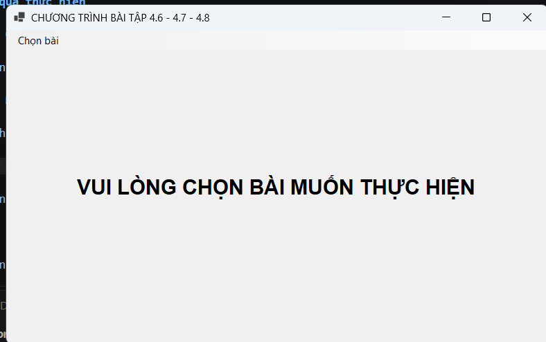

#### Ảnh 2: Thêm sinh viên

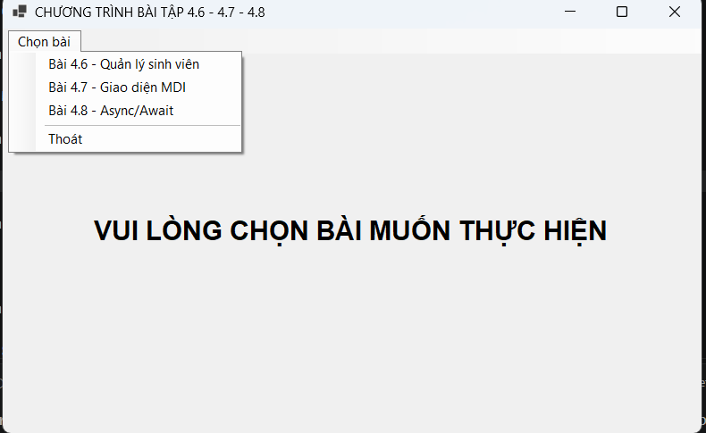

#### Ảnh 3: chọn ảnh đại diện

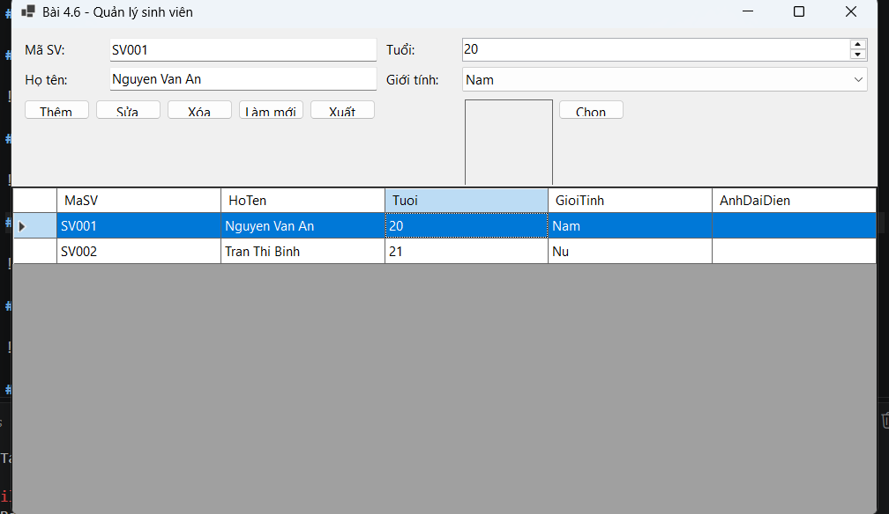

#### Ảnh 4: Xóa sinh viên

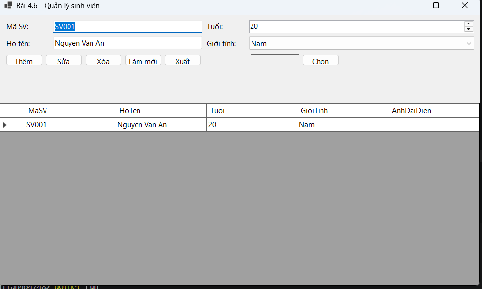

#### Ảnh 4: xuất dữ liệu CSV

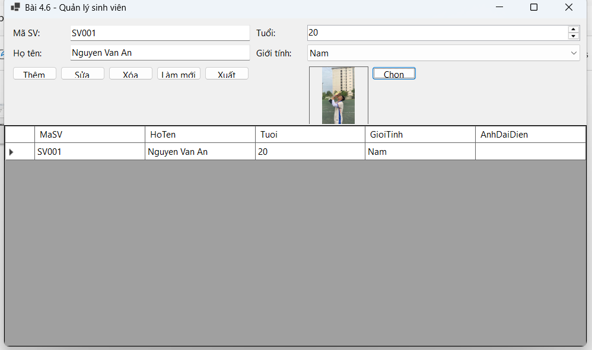

### 3.2. Bài 4.7: Thiết kế khung ứng dụng MDI và quản lý đa cửa sổ

**Các chức năng đã thực hiện:**

- Xây dựng FormMain với thuộc tính IsMdiContainer = true.
- Tích hợp MenuStrip, ToolStrip, StatusStrip và ContextMenuStrip.
- Tạo menu Hệ thống, Danh mục và Cửa sổ.
- Mở các Form chức năng Quản lý sinh viên và Quản lý sản phẩm.
- Kiểm tra Form con đã mở để tránh tạo nhiều cửa sổ trùng lặp.
- Hỗ trợ sắp xếp cửa sổ con theo Cascade, Tile Horizontal và Tile Vertical.
- Cập nhật trạng thái trên StatusStrip khi Form con thực hiện thao tác.
- Tích hợp menu ngữ cảnh trên DataGridView.

#### Ảnh 4: Giao diện chính MDI

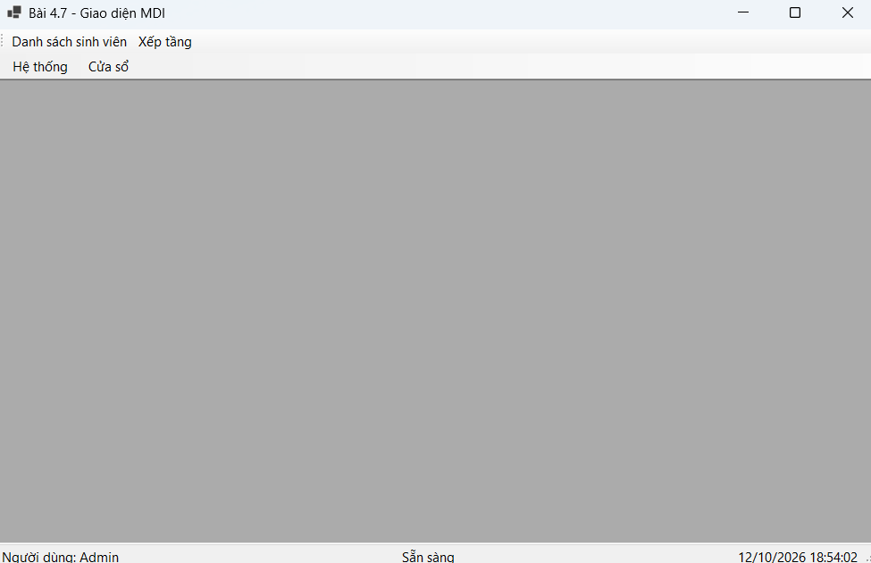

#### Ảnh 5: Menu danh mục và cửa sổ

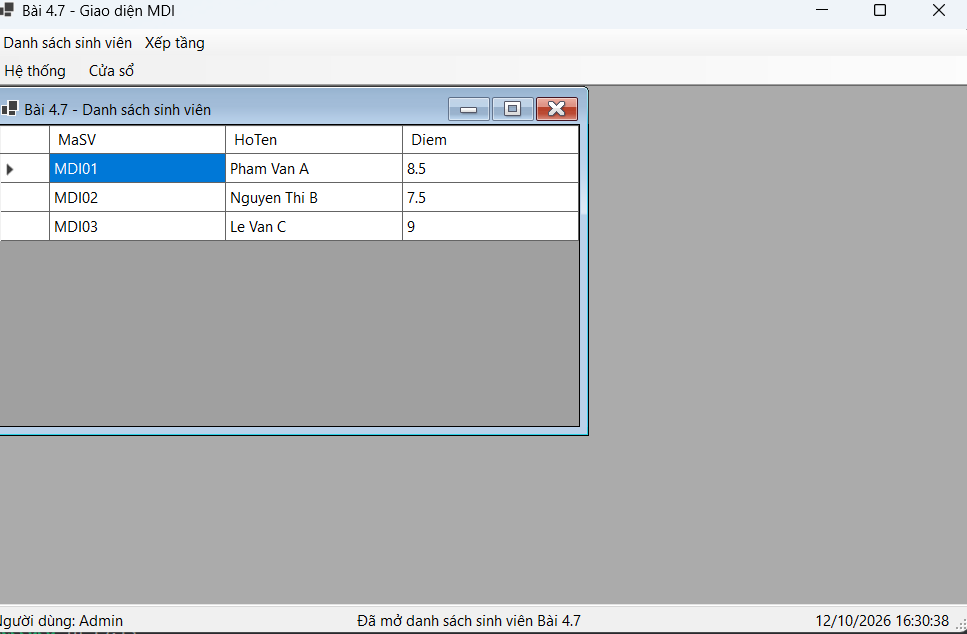

#### Ảnh 6: Quản lý nhiều cửa sổ con

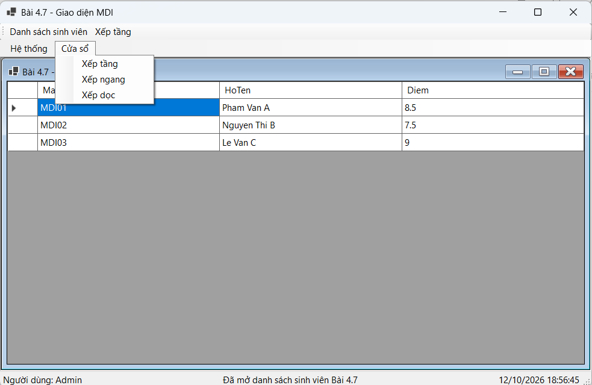

### 3.3. Bài 4.8: Lập trình bất đồng bộ và ProgressBar

**Các chức năng đã thực hiện:**

- Xây dựng phương thức nạp dữ liệu bất đồng bộ sử dụng async/await.
- Sử dụng Task.Run và Task.Delay để mô phỏng quá trình nạp dữ liệu.
- Tích hợp ProgressBar và Label hiển thị phần trăm hoàn thành.
- Sử dụng IProgress<int> để cập nhật tiến trình trên giao diện.
- Đồng bộ phần trăm tiến trình lên StatusStrip của FormMain.
- Khóa nút nạp dữ liệu trong khi tác vụ đang chạy để tránh thực hiện trùng lặp.
- Sử dụng try...catch...finally để xử lý lỗi và khôi phục trạng thái giao diện.

#### Ảnh 7: Giao diện nạp dữ liệu bất đồng bộ

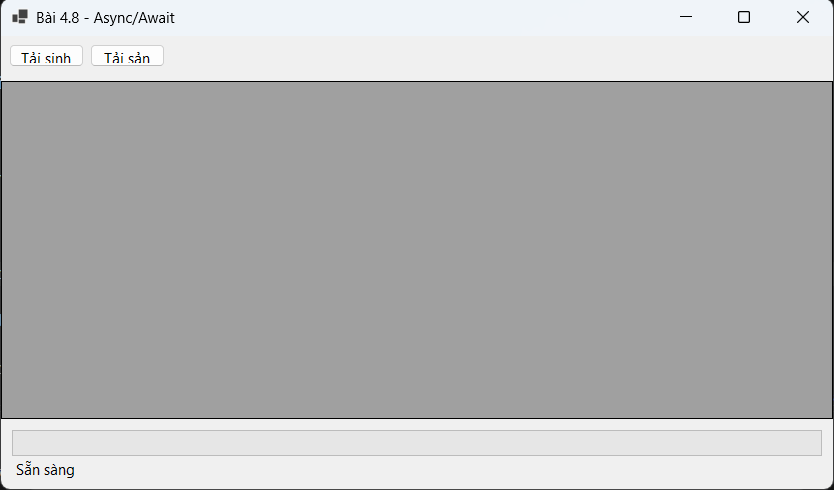

#### Ảnh 8: Hiển thị tiến trình nạp dữ liệu

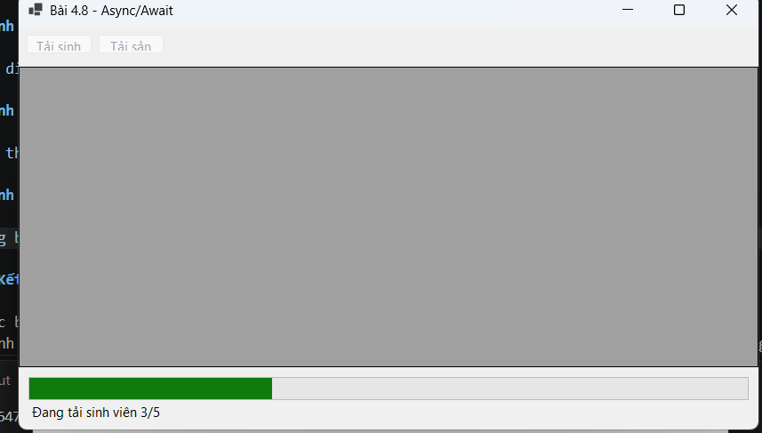

#### Ảnh 9: Thông báo hoàn tất

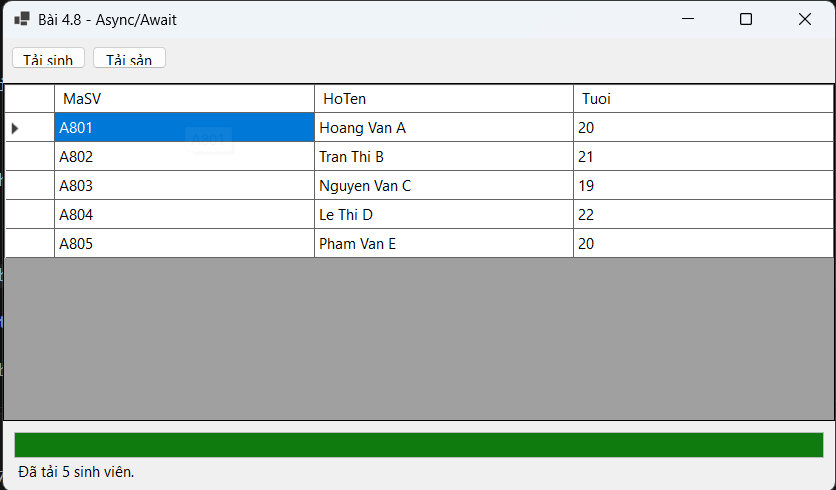

## 4. Kết luận

Qua các bài thực hành, em đã nắm được cách liên kết dữ liệu hai chiều trong Windows Forms, thao tác với file ảnh và CSV, xây dựng ứng dụng MDI quản lý nhiều cửa sổ, cũng như áp dụng lập trình bất đồng bộ để cải thiện khả năng phản hồi của giao diện người dùng.

Các chức năng được xây dựng giúp ứng dụng có cấu trúc rõ ràng, thuận tiện cho việc quản lý dữ liệu và mở rộng trong các bài thực hành tiếp theo.
